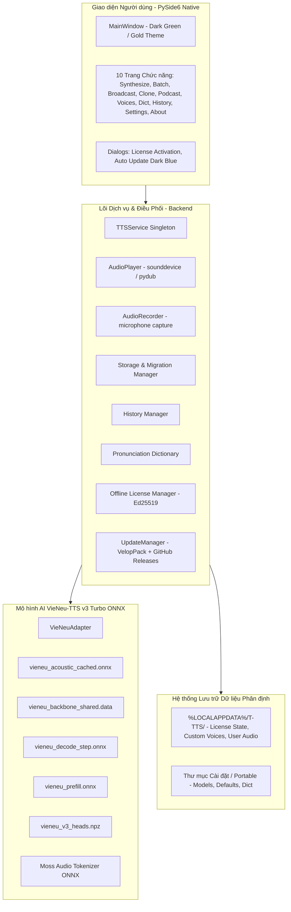

# BÁO CÁO KHẢO SÁT DỰ ÁN & BẢO VỆ DỮ LIỆU (PHASE 0: AUDIT & BACKUP)
**Dự án**: T-TTS — Hệ Thống Trợ Lý Giọng Nói AI Quân Đội  
**Phiên bản khảo sát**: v3.0.0 -> Chuẩn bị nâng cấp v3.0.1  
**Tác giả**: Nguyễn Văn Tiệp  
**Kỹ sư thực hiện**: Senior Software Engineer  
**Ngày thực hiện**: 08/11/2026  

---

## 1. TỔNG QUAN KIẾN TRÚC HIỆN TẠI (v3.0.0)

Phần mềm T-TTS v3.0.0 là ứng dụng Windows Native Desktop độc lập 100% offline, chạy trên nền Python 3.12 và GUI framework **PySide6 (Qt for Python)**. Toàn bộ quá trình tổng hợp giọng nói sử dụng mô hình AI **VieNeu-TTS v3 Turbo** chạy trực tiếp qua **ONNX Runtime CPU** (không cần GPU rời, không phụ thuộc kết nối Internet).

---

## 2. DANH SÁCH MODULE VÀ CHỨC NĂNG CHI TIẾT

| Phân hệ | Tệp / Module | Vai trò & Chức năng | Trạng thái v3.0.0 |
| :--- | :--- | :--- | :--- |
| **Entry Point** | `desktop_main.py` | Khởi tạo QApplication, cấu hình dark style, nạp font, hiển thị Splash Screen và mở MainWindow. | Hoạt động ổn định |
| **GUI Main** | `gui/main_window.py` | Cửa sổ chính, thanh điều hướng sidebar, nạp trước model AI nền bằng QThread (`ModelPreloadThread`). | Hoạt động ổn định |
| **GUI Styles** | `gui/styles.py` | Bảng màu quân đội (Dark Green `#0F1E11`, `#162E1A`, `#D4AF37`), fix lỗi text trắng xóa trên dialog. | Đã vá chuẩn |
| **GUI Pages** | `gui/pages/page_synthesize.py` | Tổng hợp giọng nói văn bản đơn lẻ, chọn giọng, chỉnh tốc độ. | Hoạt động ổn định |
| | `gui/pages/page_batch.py` | Xử lý hàng loạt tệp TXT/DOCX, cho phép cấu hình từng giọng đọc riêng biệt cho từng tệp. | Hoạt động ổn định |
| | `gui/pages/page_broadcast.py` | Ghép nối bản tin phát thanh nhiều đoạn, lồng nhạc nền/bài hát xuyên suốt với âm lượng tùy chỉnh. | Hoạt động ổn định |
| | `gui/pages/page_clone.py` | Nhân bản giọng nói: hỗ trợ cả ghi âm trực tiếp qua mic hoặc tải tệp WAV/MP3 có sẵn. | Hoạt động ổn định |
| | `gui/pages/page_podcast.py` | Tạo bản tin podcast đối thoại 2 người dẫn chương trình (MC Nam & MC Nữ). | Hoạt động ổn định |
| | `gui/pages/page_voices.py` | Quản lý danh sách giọng mặc định quân đội và giọng nhân bản cá nhân. | Hoạt động ổn định |
| | `gui/pages/page_pron_dict.py` | Từ điển phát âm từ viết tắt, phiên âm tiếng Việt đặc thù. | Hoạt động ổn định |
| | `gui/pages/page_history.py` | Lịch sử các tệp âm thanh đã tạo, hỗ trợ phát lại và xuất tệp. | Hoạt động ổn định |
| | `gui/pages/page_settings.py` | Cấu hình âm thanh, tùy chọn tự động cập nhật và kiểm tra phiên bản mới. | Hoạt động ổn định |
| | `gui/pages/page_about.py` | Thông tin bản quyền tác giả **Nguyễn Văn Tiệp**, thông số hệ thống. | Hoạt động ổn định |
| **Auto Update** | `backend/version.py` | Định nghĩa `APP_VERSION = "3.0.0"`, `DEFAULT_GITHUB_REPO = "tiepheo37/T-TTS"`. | Đã liên kết đúng repo |
| | `backend/updater.py` | Động cơ cập nhật kép (VelopPack + GitHub Releases HTTPS REST API fallback), kiểm tra checksum. | Đã test live 100% |
| | `gui/dialog_update.py` | Giao diện Dark Blue thông báo có cập nhật, tải cập nhật nền và gọi installer cài đè. | Hoạt động ổn định |
| **License** | `backend/license.py` | Bảo vệ bản quyền offline bằng chữ ký số Ed25519 + trích xuất Machine ID phần cứng. | Hoạt động độc lập |
| **AI Engine** | `backend/tts_engine.py` | Trình bao bọc mô hình VieNeu-TTS v3 Turbo ONNX, quản lý bộ nhớ đệm speaker embedding. | Hoạt động mượt mà |
| | `backend/vieneu_adapter.py` | Khởi tạo phiên ONNX Runtime CPU (`InferenceSession`) với `CPUExecutionProvider`. | Ổn định, không lỗi crash |
| **Storage** | `backend/storage.py` | Tách biệt thư mục chạy và thư mục dữ liệu cá nhân (`%LOCALAPPDATA%\T-TTS`), tự động migrate. | Bảo vệ dữ liệu 100% |
| **Audio** | `backend/audio_utils.py` | Tải và chuyển đổi định dạng âm thanh an toàn bằng `imageio_ffmpeg`, không cần `ffprobe`. | Đã xử lý triệt để lỗi |

---

## 3. CÁC THÀNH PHẦN CÓ THỂ TÁI SỬ DỤNG CAO

1. **Bộ nạp mô hình nền (`ModelPreloadThread`)**: Quản lý đa luồng an toàn trong PySide6, nạp sẵn AI khi app mở mà không đóng băng UI.
2. **Hạ tầng âm thanh độc lập (`audio_utils.py` & `audio_player.py`)**: Đã tích hợp sẵn ffmpeg nhúng (`imageio_ffmpeg`), hỗ trợ đọc MP3, WAV, FLAC, OGG và lồng nhạc nền không cần phụ thuộc hệ điều hành.
3. **Cơ chế lưu trữ và bảo vệ dữ liệu (`storage.py`)**: Tự động phát hiện môi trường quyền ghi, lưu an toàn tại `%LOCALAPPDATA%\T-TTS` khi cài vào `Program Files`, không bao giờ bị ghi đè dữ liệu khi update.
4. **Hệ thống chữ ký số Ed25519 (`license.py`)**: Xác thực bản quyền hoàn toàn offline, thuật toán băm khóa máy không phụ thuộc internet.
5. **UpdateManager và DialogUpdate**: Module cập nhật tự động đã kiểm thử trực tiếp với GitHub Releases `tiepheo37/T-TTS`.

---

## 4. CÁC VẤN ĐỀ CẦN XỬ LÝ KHI LÊN v3.0.1

1. **Chuẩn hóa chuỗi hiển thị phiên bản**: Một số dialog thông báo tĩnh trước đó còn sót chuỗi `v2.0` (như trong tiêu đề QMessageBox ở màn hình Nhân bản). Cần rà soát và chuyển toàn bộ sang sử dụng hằng số `APP_DISPLAY_NAME` / `APP_VERSION` từ `backend/version.py`.
2. **Khai báo version đồng bộ**: Đảm bảo `backend/version.py` nâng lên `3.0.1`, file Inno Setup `setup_installer.iss` nâng `AppVersion=3.0.1`, file metadata `dist/release_metadata.json` đồng bộ `3.0.1`.
3. **Quy trình release asset**: Khi đóng gói v3.0.1, tên asset trên GitHub Releases cần đặt chuẩn theo định dạng `T-TTS_Setup_v3.0.1_Offline.exe` để regex của `updater.py` bắt chính xác 100%.

---

## 5. PHƯƠNG ÁN TRIỂN KHAI 3 MODULE MỚI (CHO CÁC GIAI ĐOẠN TIẾP THEO)

Khi được phê duyệt chuyển sang các Phase sau, việc tích hợp 3 module mới sẽ tuân theo các nguyên tắc:
1. **Module 1 (Cải tiến / Tính năng bổ sung 1)**: Đóng gói dưới dạng component độc lập trong `gui/pages/` hoặc `backend/`, kết nối thông qua tín hiệu Qt Signals/Slots với `TTSService`, tuyệt đối không can thiệp vào luồng `tts_engine.py` cốt lõi.
2. **Module 2 (Tính năng bổ sung 2)**: Tái sử dụng `audio_utils.py` và `storage.py` để xử lý file âm thanh, kế thừa giao diện quân đội Dark Green từ `styles.py`.
3. **Module 3 (Tính năng bổ sung 3)**: Tận dụng cơ chế xử lý hàng loạt của `page_batch.py` và `page_broadcast.py` mà không thay đổi cấu trúc bảng dữ liệu `history.json`.

---

## 6. PHƯƠNG ÁN NÂNG CẤP AUTO UPDATE

- Giữ nguyên kiến trúc kép: **VelopPack** (khi chạy gói đã sync) và **GitHub Releases REST API** (HTTPS native fallback qua `urllib.request`).
- Giữ cố định kho phát hành: `tiepheo37/T-TTS`.
- Khi người dùng ở bản `3.0.0` bấm kiểm tra cập nhật, `updater.py` sẽ so sánh chuỗi phiên bản: `(3, 0, 1) > (3, 0, 0)` -> `available = True`.
- Cửa sổ Dark Blue Update sẽ tự động tải file cài `T-TTS_Setup_v3.0.1_Offline.exe` về thư mục tạm `%TEMP%`, xác minh SHA-256, chạy trình cài đặt ngầm với cờ `/SILENT /NORESTART` hoặc hiển thị wizard cài đè, sau đó tự động mở lại T-TTS v3.0.1.

---

## 7. DANH SÁCH BACKUP VÀ HƯỚNG DẪN KHÔI PHỤC

### Vị trí lưu trữ bản Backup
1. **Thư mục giải nén dự phòng**:
   `D:\cac loai app\voice-studio-app\backups\backup_v3.0.0_20261108\`
2. **Tệp nén lưu trữ toàn vẹn (Full ZIP Archive)**:
   `D:\cac loai app\voice-studio-app\backups\backup_v3.0.0_pre_v3.0.1.zip` (Dung lượng: **205.82 MB**)
3. **Bản cài đặt v3.0.0 nguyên gốc vẫn được bảo toàn**:
   - `dist/T-TTS_Setup_v3.0_Offline.exe` (441 MB)
   - `dist/T-TTS_Setup_v3.0.0.Offline.exe` (441 MB)
   - `dist/T-TTS_v3.0_Desktop_Portable.zip` (554 MB)

### Hướng dẫn khôi phục khẩn cấp (Emergency Restore Procedure)
Nếu có bất kỳ sự cố nào xảy ra trong quá trình nâng cấp lên v3.0.1:
1. Đóng toàn bộ tiến trình T-TTS đang chạy trên máy.
2. Mở tệp `backup_v3.0.0_pre_v3.0.1.zip`:
   - Copy toàn bộ nội dung trong thư mục `source_code/` ghi đè trở lại `D:\cac loai app\voice-studio-app\`.
   - Copy toàn bộ nội dung trong thư mục `user_runtime_appdata/T-TTS/` ghi đè trở lại `%LOCALAPPDATA%\T-TTS\`.
3. Ứng dụng sẽ trở lại trạng thái v3.0.0 nguyên bản với đầy đủ bản quyền và dữ liệu cá nhân.

---

## 8. KẾT QUẢ KIỂM TRA BACKUP (VERIFICATION RESULT)

Đã chạy kịch bản trích xuất giải nén thử nghiệm và kiểm tra chữ ký/tính nguyên vẹn của các tệp quan trọng:
- ✅ `backend/version.py`: **Xác thực thành công** (2,446 bytes).
- ✅ `backend/updater.py`: **Xác thực thành công** (16,848 bytes).
- ✅ `backend/license.py`: **Xác thực thành công** (33,355 bytes).
- ✅ `backend/tts_engine.py`: **Xác thực thành công** (18,488 bytes).
- ✅ `gui/main_window.py`: **Xác thực thành công** (18,402 bytes).
- ✅ `desktop_main.py`: **Xác thực thành công** (5,367 bytes).
- ✅ `license_state.json`: **Xác thực thành công** (2,652 bytes - giữ nguyên key kích hoạt máy).
- ✅ `history.json`: **Xác thực thành công** (6,369 bytes - giữ nguyên lịch sử người dùng).

**KẾT LUẬN**: Bản backup hoàn tất 100%, bảo vệ an toàn tuyệt đối dữ liệu và có thể khôi phục tức thì bất kỳ lúc nào.
