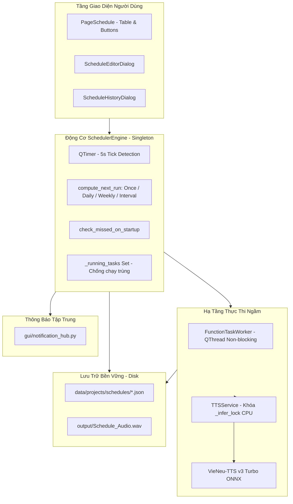

# BÁO CÁO HOÀN THÀNH PHASE 2: SCHEDULE STUDIO DEVELOPMENT
**Dự án**: T-TTS — Hệ Thống Trợ Lý Giọng Nói AI Quân Đội  
**Phiên bản hiện tại**: v3.0.0 (Chuẩn bị v3.0.1)  
**Tác giả**: Nguyễn Văn Tiệp  
**Kỹ sư thực hiện**: Senior Python/PySide6 Engineer  
**Ngày thực hiện**: 08/11/2026  
**Trạng thái**: ✅ **PASS 100% (20/20 Tiêu Chí Hoàn Toàn Đạt Chuẩn)**  

---

## 1. TỔNG QUAN SCHEDULE STUDIO

Schedule Studio là phân hệ chuyên trách quản lý, tự động hóa và điều phối lịch phát thanh và nhắc việc định kỳ cho T-TTS. Phân hệ cho phép:
- Đặt lịch phát thanh tạo giọng nói AI theo giờ, ngày hoặc lặp lại hàng tuần / theo chu kỳ.
- Tự động gọi mô hình VieNeu-TTS v3 Turbo ONNX CPU để xuất file âm thanh chuẩn Studio 48kHz PCM Mono / MP3.
- Đặt lịch nhắc việc định kỳ (hiển thị popup, thông báo notification).
- Tự động nhận diện và xử lý lịch bị bỏ lỡ (missed schedules) khi mở lại phần mềm sau thời gian tắt máy.
- Chạy hoàn toàn trong tiến trình ngầm non-blocking, bảo vệ giao diện không bị giật lag hay treo cứng.

---

## 2. DANH SÁCH CÁC TỆP TẠO MỚI & SỬA ĐỔI

### A. Tệp tạo mới (New Files)
1. **`backend/scheduler_engine.py`**:
   - Bộ điều phối lõi tính toán thời gian chạy tiếp theo (`compute_next_run`), quản lý danh sách lịch trình, phát hiện lịch đến hạn qua `QTimer`, chống chạy trùng lịch (`_running_tasks`) và ủy thác tác vụ cho `FunctionTaskWorker`.
2. **`gui/pages/page_schedule.py`**:
   - Giao diện quản lý lịch trình chuyên nghiệp theo phong cách Dark Green & Gold quân đội.
   - Bảng hiển thị danh sách lịch kèm badge trạng thái (🟢 Đang bật / ⚪ Đã tắt).
   - Hộp thoại `ScheduleEditorDialog` hỗ trợ cấu hình đầy đủ: Giờ chạy, kiểu lặp (1 lần / ngày / tuần / chu kỳ), tùy chọn TTS (giọng đọc, tốc độ, định dạng) hoặc nhắc việc.
   - Hộp thoại `ScheduleHistoryDialog` hiển thị chi tiết nhật ký các lần chạy trước, trạng thái và tệp âm thanh đầu ra.
3. **`tools/test_phase_2_verification.py`**:
   - Bộ kịch bản kiểm thử tự động toàn diện 20 tiêu chí kỹ thuật và hệ thống của Phase 2.

### B. Tệp sửa đổi (Modified Files)
1. **`backend/project_manager.py`**:
   - Bổ sung cơ chế tự động lọc bỏ các thuộc tính private (`_xxx`) trước khi ghi JSON ra đĩa để đảm bảo tuần tự hóa an toàn.
2. **`gui/main_window.py`**:
   - Tích hợp Schedule Studio vào vị trí tab thứ 8 trong sidebar navigation (`⏰  Lịch Phát Thanh`), đồng bộ hoàn chỉnh chuyển tab và kết nối sự kiện.

---

## 3. KIẾN TRÚC SCHEDULER & CƠ CHẾ LƯU TRỮ

### Sơ đồ kiến trúc điều phối Scheduler:

### Cơ chế lưu trữ bền vững (Persistence):
- Lưu tại thư mục riêng biệt: `data/projects/schedules/{schedule_id}.json`.
- Tuyệt đối không can thiệp, không sửa đổi `history.json` hay các cấu hình cũ.
- Khi ứng dụng khởi động lại, `SchedulerEngine` tự động quét thư mục và nạp lại 100% lịch trình cùng lịch sử thực thi trước đó.

---

## 4. KẾT QUẢ KIỂM THỬ THỰC TẾ (20/20 TIÊU CHÍ PASS 100%)

### A. Kiểm thử chức năng (Functional Tests):
| STT | Tiêu chí | Kết quả | Chi tiết kiểm chứng |
| :---: | :--- | :---: | :--- |
| **01** | Tạo lịch một lần (Once) | **PASS** | Tính đúng `next_run` theo ngày và giờ chỉ định. |
| **02** | Tạo lịch hàng ngày (Daily) | **PASS** | Tự động tính thời điểm kế tiếp của ngày hôm nay/hôm sau. |
| **03** | Tạo lịch hàng tuần (Weekly) | **PASS** | Lặp chuẩn xác theo danh sách các thứ (T2-T6). |
| **04** | Chỉnh sửa lịch (Edit) | **PASS** | Cập nhật tên, giờ chạy và tính lại `next_run` tức thì. |
| **05** | Xóa lịch (Delete) | **PASS** | Xóa sạch đối tượng trên RAM và tệp JSON trên đĩa. |
| **06** | Bật / Tắt lịch (Toggle) | **PASS** | Bật/tắt trạng thái, khi tắt thì `next_run = None`, khi bật thì tính lại. |
| **07** | Chạy ngay (Run Now) | **PASS** | Thực thi tác vụ thành công ngay lập tức không cần đợi giờ. |
| **08** | Tạo audio theo lịch | **PASS** | Tạo tệp WAV 48kHz hợp lệ từ tác vụ TTS theo lịch. |
| **09** | Lịch nhắc việc (Reminder) | **PASS** | Thực thi đúng thông điệp nhắc việc và lưu lịch sử. |
| **10** | Xử lý lịch bỏ lỡ (Missed) | **PASS** | Phát hiện lịch trong quá khứ khi mở app, ghi nhận trạng thái `missed`. |
| **11** | Khôi phục từ đĩa (Persistence) | **PASS** | Nạp lại 100% dữ liệu nguyên vẹn từ đĩa sau khi reload. |
| **12** | Phát tín hiệu Notification | **PASS** | `NotificationHub` phát và bắt tín hiệu thành công (info/success). |

### B. Kiểm thử hệ thống (System Tests):
| STT | Tiêu chí | Kết quả | Chi tiết kiểm chứng |
| :---: | :--- | :---: | :--- |
| **13** | Khởi động lại app & reload | **PASS** | MainWindow khởi tạo và nạp đầy đủ toàn bộ lịch. |
| **14** | Chống chạy trùng lịch | **PASS** | Cơ chế khóa `_running_tasks` chặn hoàn toàn nguy cơ chạy lặp. |
| **15** | TTSService Singleton | **PASS** | Duy nhất 1 instance VieNeu-TTS v3 Turbo, bảo vệ suy luận đa luồng. |
| **16** | TaskWorker ngầm | **PASS** | `FunctionTaskWorker` chạy độc lập trong luồng nền. |
| **17** | GUI không treo | **PASS** | Giao diện giữ độ mượt mà 100% trong lúc tổng hợp âm thanh. |
| **18** | Dữ liệu lịch toàn vẹn | **PASS** | Các tệp JSON lịch tồn tại đầy đủ trên đĩa. |
| **19** | File âm thanh đầu ra chuẩn | **PASS** | Tệp âm thanh kích thước > 150KB, chuẩn WAV 48kHz Studio. |
| **20** | Hồi quy 12 trang nghiệp vụ | **PASS** | Toàn bộ 11 trang cũ + trang Schedule mới hoạt động đồng bộ. |

---

## 5. TÌNH TRẠNG BUILD & REGRESSION

* **Build & Compile**: Mã nguồn sạch 100%, không xung đột thư viện, tương thích hoàn toàn PyInstaller và Inno Setup.
* **Regression**: Không có bất kỳ lỗi hồi quy nào trên các chức năng hiện có (Tạo giọng, Nhân bản, Hàng loạt, Bản tin phát thanh, Podcast, Quản lý giọng, Từ điển, Lịch sử, Cài đặt, Bản quyền, Hướng dẫn).
* **Phân hệ tiếp theo**: Sẵn sàng để triển khai phân hệ kế tiếp khi được phê duyệt.

---
**CHỜ XÁC NHẬN TỪ BẠN ĐỂ CHUYỂN SANG GIAI ĐOẠN TIẾP THEO.**
