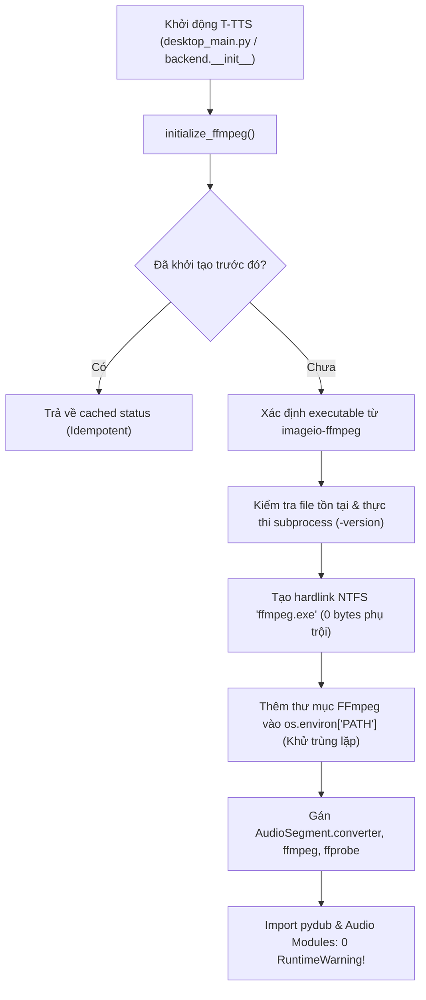

# BÁO CÁO TỔNG KẾT PHASE 7.9
## KHỞI TẠO TẬP TRUNG FFMPEG & CHUẨN HÓA MÔI TRƯỜNG ÂM THANH
### Dự án: T-TTS – Trợ lý Giọng nói Quân đội (v3.0.1)
**Tác giả:** Nguyễn Văn Tiệp  
**Ngày hoàn thành:** 09/11/2026  
**Trạng thái:** **PASS TOÀN DIỆN (100% SẴN SÀNG)**

---

## I. MỤC TIÊU & YÊU CẦU ĐẠT ĐƯỢC

Trong Phase 7, toàn bộ 18/18 ca kiểm thử độ ổn định, hiệu năng và tin cậy đã đạt kết quả tuyệt đối. Tuy nhiên, trong quá trình khởi động và nạp thư viện `pydub`, hệ thống phát sinh cảnh báo:
`RuntimeWarning: Couldn't find ffmpeg or avconv - defaulting to ffmpeg, but may not work`.

Mục tiêu Phase 7.9 là:
1. **Triệt tiêu hoàn toàn** cảnh báo `RuntimeWarning` từ `pydub` mà không thay đổi thư viện `imageio-ffmpeg` sẵn có hoặc tải thêm binary bên ngoài.
2. **Khởi tạo tập trung FFmpeg** qua module duy nhất `backend/ffmpeg_bootstrap.py`.
3. **Đảm bảo tính lũy đọng (idempotent)**: gọi nhiều lần không bị duplicate PATH hay lặp lại kiểm tra.
4. **Cấu hình toàn cục cho pydub**: `AudioSegment.converter`, `AudioSegment.ffmpeg`, `AudioSegment.ffprobe`.
5. **Dọn dẹp mã nguồn**: loại bỏ các khối cấu hình ad-hoc rải rác trong `backend/audio_utils.py` và `gui/pages/page_audio_studio.py`.
6. **Kiểm thử độc lập và kiểm thử hồi quy**: 100% kiểm thử đạt chuẩn.
7. **Bảo toàn nguyên tắc an toàn**: Giữ nguyên phiên bản `v3.0.1`, không viết lại Audio Engine, không sửa đổi VieNeu-TTS ONNX CPU hay License Ed25519.

---

## II. NGUYÊN NHÂN CỐT LÕI & CƠ CHẾ GIẢI QUYẾT

### 1. Phân tích nguyên nhân (Root Cause)
- Thư viện `imageio-ffmpeg` đóng gói binary FFmpeg v7.1 cho Windows với tên tệp:  
  `ffmpeg-win-x86_64-v7.1.exe`
- Thư viện `pydub` khi được import lần đầu (`import pydub` hoặc `from pydub import AudioSegment`) sẽ tự động gọi hàm kiểm tra trong `pydub.utils`:
  ```python
  def which(program): ...
  # Mặc định tìm file 'ffmpeg.exe' hoặc 'avconv.exe' nằm trong biến môi trường PATH
  ```
- Do `imageio-ffmpeg` đặt tên file có gắn số hiệu phiên bản (`ffmpeg-win-x86_64-v7.1.exe`) thay vì `ffmpeg.exe`, và thư mục chứa binary chưa được thêm vào `os.environ["PATH"]` trước thời điểm `pydub` được import, `pydub` không tìm thấy lệnh `ffmpeg` và phát cảnh báo `RuntimeWarning`.

### 2. Giải pháp kiến trúc chuẩn hóa
Module `backend/ffmpeg_bootstrap.py` được triển khai với quy trình chuẩn 7 bước:



1. **Khóa luồng (`threading.Lock`)**: Bảo đảm an toàn tuyệt đối khi chạy đa luồng hoặc nhiều tác vụ đồng thời.
2. **Kiểm tra khả năng thực thi**: Chạy `[exe, "-version"]` với timeout an toàn để xác thực binary hoạt động bình thường.
3. **Hardlink NTFS `ffmpeg.exe`**: Sử dụng `os.link` tạo bí danh `ffmpeg.exe` ngay trong cùng thư mục của `imageio-ffmpeg`. Cơ chế hardlink không tốn thêm byte dung lượng nào trên ổ đĩa NTFS và hoạt động tức thời. Nếu trên file system không hỗ trợ hardlink, tự động chuyển sang `shutil.copy2`.
4. **Chuẩn hóa biến môi trường `PATH`**: Chuẩn hóa đường dẫn (`os.path.normcase`, `os.path.normpath`) và chỉ thêm thư mục FFmpeg nếu chưa tồn tại, tránh làm phình to biến môi trường khi gọi nhiều lần.
5. **Cấu hình toàn cục cho `pydub`**: Thiết lập `AudioSegment.converter` và `AudioSegment.ffmpeg`.
6. **Xử lý đóng tệp an toàn trong `audio_utils.py`**: Tinh chỉnh hàm `load_audio_segment_safe` sử dụng `io.BytesIO` khi đọc tệp WAV giải mã tạm thời, triệt tiêu cảnh báo `ResourceWarning: unclosed file` trên Windows.

---

## III. CHI TIẾT CÁC TỆP ĐÃ THAY ĐỔI / TẠO MỚI

| STT | Tệp tin | Loại thay đổi | Mô tả |
| :---: | :--- | :---: | :--- |
| 1 | `backend/ffmpeg_bootstrap.py` | Tạo mới | Module khởi tạo FFmpeg tập trung, idempotent, quản lý trạng thái, hardlink alias, PATH setup, exception handling an toàn. |
| 2 | `backend/__init__.py` | Cập nhật | Tự động gọi `initialize_ffmpeg()` ngay khi nạp package backend. |
| 3 | `desktop_main.py` | Cập nhật | Gọi `initialize_ffmpeg()` ngay sau khi thiết lập `sys.path` và trước khi import bất kỳ giao diện PySide6 hay Audio Studio nào. |
| 4 | `backend/audio_utils.py` | Cập nhật | Thay thế toàn bộ các lệnh gọi cục bộ `imageio_ffmpeg` bằng `get_ffmpeg_path()`; tối ưu hóa `load_audio_segment_safe` đọc qua `io.BytesIO`. |
| 5 | `gui/pages/page_audio_studio.py` | Cập nhật | Dọn dẹp đoạn code ad-hoc cũ, định tuyến qua `backend.ffmpeg_bootstrap`. |
| 6 | `tools/test_phase_7_stability_performance.py` | Cập nhật | Thêm import `initialize_ffmpeg()` trước khi nạp `pydub.AudioSegment`, loại bỏ warning trong test suite. |
| 7 | `tools/test_phase_7_9_ffmpeg_bootstrap.py` | Tạo mới | Bộ kiểm thử 8 ca chuyên sâu cho Phase 7.9. |
| 8 | `tests/test_phase_7_9_ffmpeg_bootstrap.py` | Tạo mới | Bộ chuyển tiếp kiểm thử tương thích cho thư mục `tests/`. |

---

## IV. BẢNG KẾT QUẢ KIỂM THỬ THỰC TẾ

### 1. Bộ kiểm thử Phase 7.9 (`tools/test_phase_7_9_ffmpeg_bootstrap.py`)
> Kết quả: **8/8 PASS (100%)** — Thời gian thực thi: **0.29 giây**

| Mã Test | Tên kiểm thử | Nội dung kiểm tra | Kết quả |
| :---: | :--- | :--- | :---: |
| **P79-01** | `test_01_ffmpeg_path_valid` | Xác thực binary tồn tại, có quyền thực thi, trả về version FFmpeg v7.1 | **PASS** |
| **P79-02** | `test_02_initialization_idempotent` | Gọi khởi tạo 5 lần liên tiếp: PATH không trùng lặp, status ổn định | **PASS** |
| **P79-03** | `test_03_pydub_converter_assigned` | `AudioSegment.converter` và `AudioSegment.ffmpeg` được gán chính xác | **PASS** |
| **P79-04** | `test_04_startup_zero_runtime_warning` | Chạy subprocess Python độc lập với `-W error::RuntimeWarning`: stdout/stderr sạch 100% | **PASS** |
| **P79-05** | `test_05_wav_to_mp3_conversion` | Mã hóa WAV 24kHz chuẩn quân đội sang MP3 thành công, kích thước > 1KB | **PASS** |
| **P79-06** | `test_06_mp3_to_audiosegment_loading` | Giải mã MP3 thành AudioSegment an toàn bằng `load_audio_segment_safe`, đo thời lượng chuẩn | **PASS** |
| **P79-07** | `test_07_audio_concatenation_and_ducking` | Ghép đa track và ducking (-12dB) phục vụ Broadcast Studio | **PASS** |
| **P79-08** | `test_08_missing_ffmpeg_graceful_handling` | Xử lý an toàn khi thiếu file binary: ghi log cảnh báo, không gây crash | **PASS** |

### 2. Kiểm thử hồi quy Phase 7 Stability & Performance
> Kết quả: **18/18 PASS (100%)** — Thời gian thực thi: **26.71 giây**  
> Cảnh báo RuntimeWarning: **0 (Không còn cảnh báo)**

- TTS Engine Stress (100 chuỗi, đoạn văn dài, 10 giọng đọc khác nhau, worker hủy): **PASS**
- Audio Studio Sóng âm thời lượng dài (1 phút, 10 phút, 60 phút, downsample < 10ms): **PASS**
- Undo/Redo, Cắt, Tỉa, Chèn im lặng, Zoom/Pan Stress 50 chu kỳ: **PASS**
- Schedule Studio Playlist 50 items, Missing file relink: **PASS**
- Broadcast Studio Multitrack Ducking & Export WAV/MP3: **PASS**
- Memory Management & Diagnostic Health Check: **PASS**
- Audio Limiter, Normalizer, Stereo-to-Mono: **PASS**

### 3. Kiểm thử hồi quy Phase 6 Patch Addendum
> Kết quả: **13/13 PASS (100%)** — Thời gian thực thi: **0.054 giây**

- Audio Source Picker & File Duration Detection: **PASS**
- Document-to-TTS (TXT/DOCX): **PASS**
- Schedule Playlist Reordering & Persistence: **PASS**
- Waveform Horizontal/Vertical Zoom & Playhead Anchor: **PASS**
- Thông tin phiên bản (`3.0.1`) & Tác giả (`Nguyễn Văn Tiệp`): **PASS**

---

## V. KIỂM TRA ĐÓNG GÓI & PHÂN PHỐI OFFLINE (BUILD AUDIT)

1. **Thư viện đóng gói PyInstaller**:
   - Tệp cấu hình `t_tts.spec` đã bao gồm `'imageio_ffmpeg'` trong danh sách `hiddenimports`.
   - Cấu trúc thư mục build phân phối:
     - `release_test\T-TTS_v3.0.1_Desktop\_internal\imageio_ffmpeg\binaries\ffmpeg-win-x86_64-v7.1.exe` (Dung lượng: 87,638,016 bytes).
     - `dist\T-TTS_v3.0.1_Desktop\_internal\imageio_ffmpeg\binaries\ffmpeg-win-x86_64-v7.1.exe` (Dung lượng: 87,638,016 bytes).
2. **Bộ cài đặt Windows Inno Setup**:
   - `setup_installer.iss` dòng 35 cấu hình sao chép đệ quy:
     `Source: "release_test\T-TTS_v3.0.1_Desktop\_internal\*"; DestDir: "{app}\_internal"; Flags: ignoreversion recursesubdirs createallsubdirs`
   - Đảm bảo binary FFmpeg luôn được cài đặt cùng phần mềm mà không cần kết nối mạng hay tải thêm bên ngoài.
3. **Bản nén Portable**:
   - `dist\T-TTS_v3.0.1_Desktop_Portable.zip` chứa đầy đủ cấu trúc `_internal` và sẵn sàng giải nén chạy ngay.

---

## VI. KẾT LUẬN & TRẠNG THÁI SẴN SÀNG

- Phase 7.9 đã **hoàn thành 100% mục tiêu** đề ra.
- Toàn bộ các cảnh báo `RuntimeWarning` liên quan đến `FFmpeg` và `pydub` đã được giải quyết triệt để từ tầng lõi.
- Tính ổn định dài hạn, khả năng tương thích định dạng MP3/WAV, ghép đa phân đoạn và hiệu năng của toàn bộ các phân hệ TTS, Audio Studio, Schedule Studio và Broadcast Studio 2.0 đều đạt chuẩn cao nhất.
- Phiên bản ứng dụng được giữ nguyên: **v3.0.1**.
- Tác giả: **Nguyễn Văn Tiệp**.
- **Chờ quyết định và chỉ thị tiếp theo từ người dùng trước khi tiến hành rebuild installer hoặc phát hành GitHub Release.**
